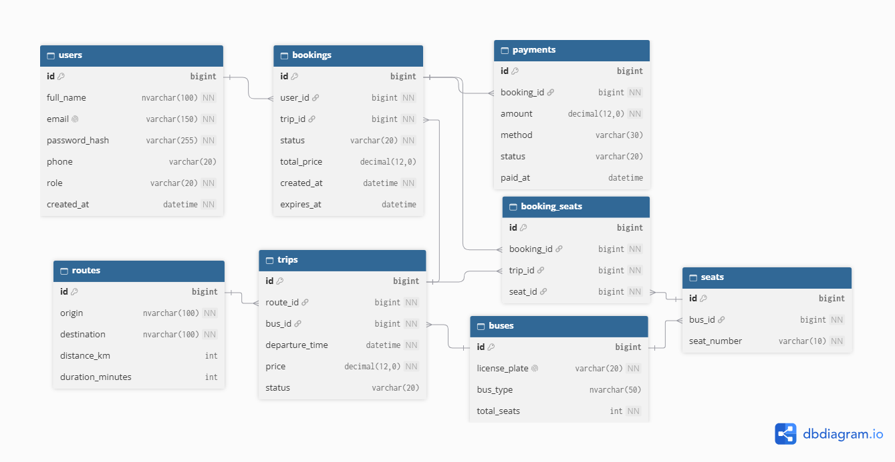

# Bus Booking System

Hệ thống đặt vé xe khách từ TP. Hồ Chí Minh đi các tỉnh thành.

> Dự án cá nhân đang phát triển, làm để học và xây dựng portfolio.

## Công nghệ

- Java 21, Spring Boot, Spring Data JPA
- SQL Server
- Maven

## Tính năng dự kiến

- [ ] Quản lý tuyến xe
- [ ] Quản lý xe và chuyến
- [ ] Tìm kiếm chuyến theo điểm đi, điểm đến, ngày
- [ ] Đăng ký / đăng nhập, phân quyền
- [ ] Chọn ghế và đặt vé (chống đặt trùng ghế)
- [ ] Thanh toán sandbox
- [ ] Trang quản trị
## Sơ đồ CSDL



Điểm thiết kế chính: ràng buộc unique `(trip_id, seat_id)` ở bảng `booking_seats` đảm bảo một ghế chỉ thuộc một vé trong cùng một chuyến, kể cả khi nhiều người đặt cùng lúc.
## Cách chạy

1. Cài JDK 21 và SQL Server, tạo database `bus_booking`
2. Đặt biến môi trường `DB_PASSWORD` là mật khẩu của tài khoản SQL Server
3. Chạy lệnh:

```
./mvnw spring-boot:run
```

Ứng dụng chạy tại `http://localhost:8080`.

## Tác giả

Phạm Minh Quân